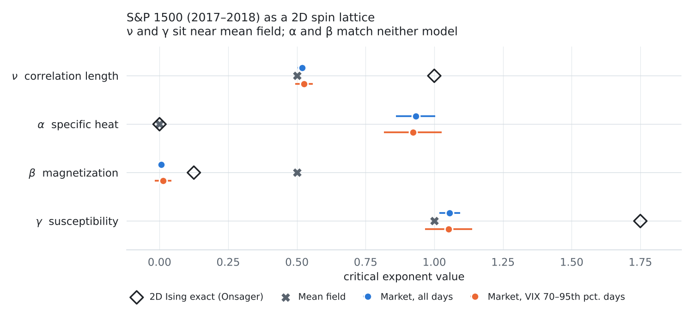
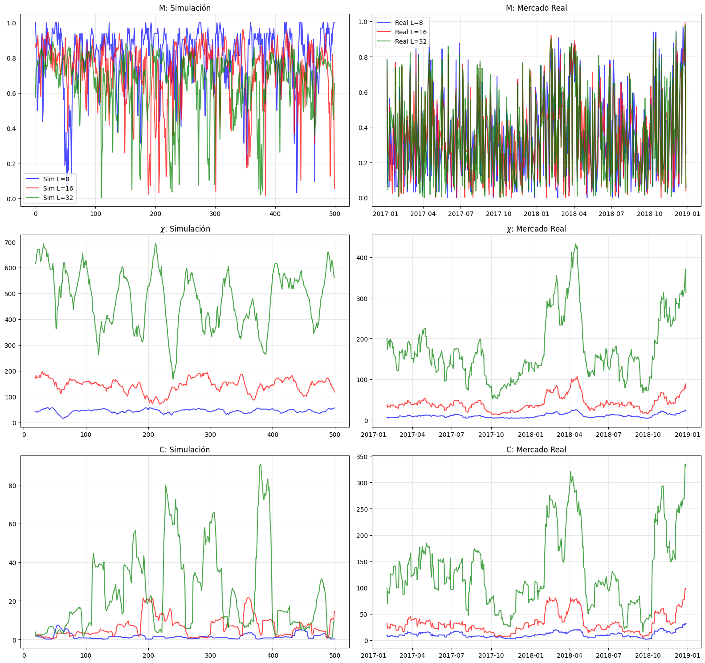
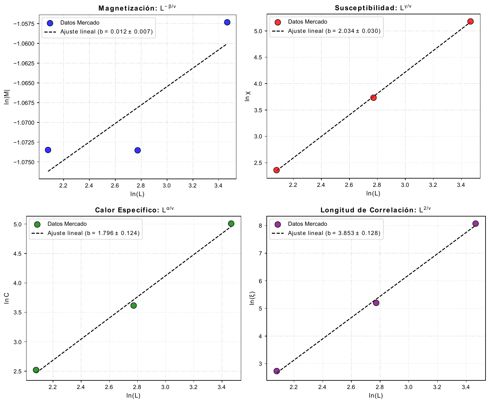
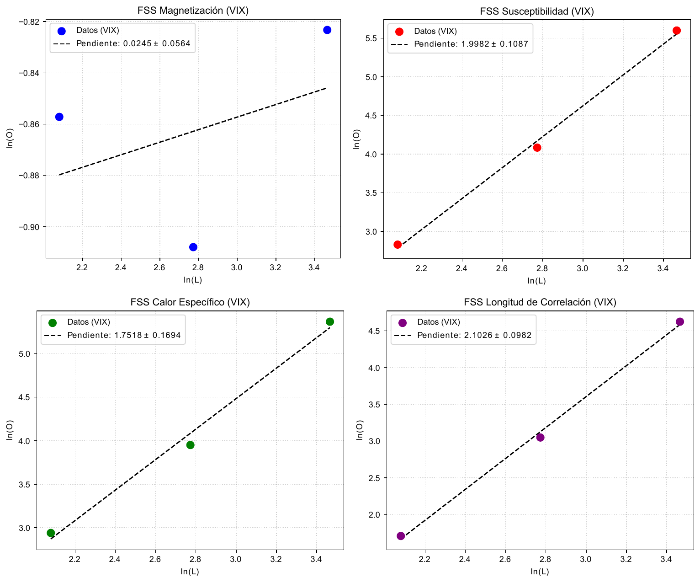

# Ising2D-Finance

**The two-dimensional Ising model: Monte Carlo simulations, finite-size scaling, and a test on real financial markets.**

[](report/Ising_model_applied_to_finance_Mario_Cordoba.pdf)


Mario Córdoba Burgueño · BSc in Physics, Universidad Complutense de Madrid · April 2026

---

## Overview

The project has two parts.

1. **Monte Carlo study of the 2D Ising model** on a square lattice with periodic boundary conditions. It compares the Heat Bath and Swendsen–Wang algorithms (thermalization, autocorrelation times, dynamic exponent $z$), checks the simulations against Onsager's exact solution, and extracts every critical exponent by finite-size scaling (FSS) with lattices up to $L = 1024$.
2. **Is the stock market a 2D Ising magnet?** Daily price moves of S&P 1500 companies are mapped to spins on a square lattice ordered by sector. The same FSS analysis is then applied to the market to see which universality class, if any, it belongs to.

The full write-up is in [`report/`](report/Ising_model_applied_to_finance_Mario_Cordoba.pdf).

## Key results

<picture>
  <source media="(prefers-color-scheme: dark)" srcset="figures/critical_exponents_dark.png">
  
</picture>

- **Simulations reproduce the exact 2D Ising exponents.** FSS gives $\beta$, $\eta$, $\nu$, $\delta$ and $\alpha$ within 1σ of Onsager's solution, and the hyperscaling relation returns $d = 2.001 \pm 0.015$.
- **Swendsen–Wang beats critical slowing down.** At $L = 128$ the energy autocorrelation time is about 90 times shorter than with Heat Bath, and the dynamic exponent drops from $z \approx 2$ to $z \approx 0.2$.
- **The market is not a 2D Ising magnet.** Its exponents are far from Onsager's values (between 4σ and 34σ away). $\nu$ and $\gamma$ are compatible with **mean field**, as if every company coupled to one global up/down trend, while $\alpha$ and $\beta$ fit neither model.

## Part 1: Monte Carlo study of the 2D Ising model

$$H = -J \sum_{\langle i,j \rangle} s_i s_j, \qquad s_i = \pm 1, \qquad K_c = \tfrac{1}{2}\ln\left(1+\sqrt{2}\right) \approx 0.4407$$

**Critical exponents from finite-size scaling**

| Quantity | This work | Exact |
|---|---|---|
| $\beta$ (with first-order corrections) | 0.12496 ± 0.00070 | 1/8 |
| $\eta$ | 0.24977 ± 0.00029 | 1/4 |
| $\nu$ | 1.0007 ± 0.0010 | 1 |
| $\gamma$ | 1.75176 ± 0.00077 | 7/4 |
| $\delta$ (Widom relation) | 15.019 ± 0.079 | 15 |
| $\alpha$ (Griffiths relation) | −0.002 ± 0.015 | 0 (log) |
| $d = (2-\alpha)/\nu$ | 2.001 ± 0.015 | 2 |

**Dynamic exponent** $\tau_{\mathrm{int}} \sim L^{z}$

| Observable | Heat Bath | Swendsen–Wang |
|---|---|---|
| Energy | 1.744 ± 0.012 | 0.2675 ± 0.0070 |
| $M^2$ | 2.143 ± 0.029 | 0.186 ± 0.011 |

The report also covers the thermodynamic limit of $M$ and $C$ against Onsager's solution, a fit of $K_c$ from the correlation length, and an exact check for $L = 2$. The simulations for this part were run with a C Monte Carlo program (`ising2d.c`) and fitted with gnuplot. That code is not included in this repository.

## Part 2: The S&P 1500 as a spin lattice

**Mapping.** Each company is a spin: $s_i = +1$ if its closing price went up with respect to the previous day and $s_i = -1$ if it went down. Companies are placed on an $L \times L$ lattice grouped by GICS sector (banks next to banks, energy next to energy, and so on), with $L = 8, 16, 32$ (up to 1024 companies). The market is assumed to sit at the critical coupling $K_c$, with the same coupling between all neighbours.

**Analysis.** For each lattice size the notebooks compute the magnetization, susceptibility, specific heat and correlation length. The exponent ratios come from linear fits of $\ln\langle O\rangle_L$ against $\ln L$, using $\langle O\rangle_L \sim L^{x_O/\nu}$. $\nu$ then follows from the Rushbrooke relation $\alpha + 2\beta + \gamma = 2$. The analysis is run twice:

- on **all trading days** of 2017–2018;
- on **high-volatility days only**, where the VIX is between its 70th and 95th percentiles. The idea is to keep only the days closest to a "critical temperature" while leaving out extreme news days, which behave like an external magnetic field.

| Exponent | Market, all days | Market, VIX-filtered | 2D Ising (Onsager) | Mean field |
|---|---|---|---|---|
| $\nu$ | 0.519 ± 0.017 | 0.526 ± 0.032 | 1 | 1/2 |
| $\alpha$ | 0.932 ± 0.071 | 0.922 ± 0.105 | 0 | 0 |
| $\beta$ | 0.006 ± 0.004 | 0.013 ± 0.030 | 1/8 | 1/2 |
| $\gamma$ | 1.056 ± 0.038 | 1.052 ± 0.086 | 7/4 | 1 |

A nearest-neighbour Ising Hamiltonian without an external field cannot capture real markets. In real markets, interactions are long-range, some are negative (competitors), and news acts as an external field. The mean-field-like $\nu$ and $\gamma$ suggest an effective global coupling to the overall market trend.

<details>
<summary><b>More figures</b></summary>

**Simulation at $K_c$ compared with the real market** (magnetization, susceptibility and specific heat for $L = 8, 16, 32$)



**FSS fits, all days**



**FSS fits, VIX-filtered days**



</details>

## Repository structure

```
Ising2D-Finance/
├── report/
│   └── Ising_model_applied_to_finance_Mario_Cordoba.pdf   full report
├── notebooks/
│   ├── 01_market_fss_all_days.ipynb       market analysis, all days (Table 15 of the report)
│   ├── 02_market_fss_vix_filtered.ipynb   market analysis, VIX-filtered days (Table 17)
│   └── drafts/                            earlier versions kept for reference
├── figures/
│   ├── *.png                              figures shown in this README
│   ├── make_critical_exponents_figure.py  script for the summary figure
│   └── pdf/                               vector figures exported by the notebooks
└── requirements.txt
```

## Reproducing the market analysis

```bash
git clone https://github.com/cordoba87/Ising2D-Finance.git
cd Ising2D-Finance
python -m venv .venv
source .venv/bin/activate        # Windows: .venv\Scripts\activate
pip install -r requirements.txt
jupyter lab notebooks/
```

Run `01_market_fss_all_days.ipynb` and `02_market_fss_vix_filtered.ipynb` from top to bottom. They download the index constituents from Wikipedia and the 2017–2018 prices and VIX from Yahoo Finance, so an internet connection is needed. The notebooks are commented in Spanish.

> [!NOTE]
> Yahoo Finance drops delisted tickers over time, so a fresh download can give slightly different numbers from the report. When fewer companies than needed are available, notebook 02 fills the lattice by resampling existing ones (bootstrap).

## References

1. D. J. Amit and V. Martín-Mayor, *Field Theory, the Renormalization Group, and Critical Phenomena: Graphs to Computers*, 3rd ed., World Scientific (2005).
2. H. Gould and J. Tobochnik, *Statistical and Thermal Physics: With Computer Applications*, 2nd ed., Princeton University Press (2021).
3. L. Onsager, *Crystal statistics. I. A two-dimensional model with an order-disorder transition*, Phys. Rev. 65, 117 (1944).
4. R. H. Swendsen and J.-S. Wang, *Nonuniversal critical dynamics in Monte Carlo simulations*, Phys. Rev. Lett. 58, 86 (1987).
5. Market data: S&P 500/400/600 constituent lists (Wikipedia) and historical prices from Yahoo Finance via [`yfinance`](https://github.com/ranaroussi/yfinance).
